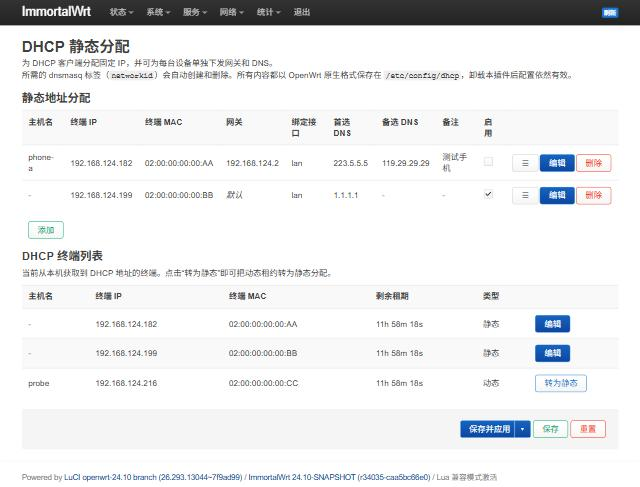

# luci-app-static-lease

OpenWrt / ImmortalWrt 的 LuCI 插件：**DHCP 静态分配，并可为每台设备单独指定网关和 DNS**。

LuCI 原生的“静态地址分配”只能固定 IP。想给某台设备下发不同的网关或 DNS（比如让手机走旁路由、电视走主路由），原本要手动建 tag、写 `dhcp_option`，再把 tag 关联到 host 上。这个插件把这些都自动化了：你只要填网关和 DNS，所需的 dnsmasq 标签由插件自动创建、复用和删除。



[English](#english)

## 功能

- 静态分配列表：主机名称、终端 IP、终端 MAC、网关、接口、首选 DNS、备选 DNS、备注、启用开关
- 网关、DNS 留空时使用 DHCP 服务器（接口）的默认值；两者可以只设其中一个
- DHCP 终端列表：实时显示当前租约，一键“转为静态”
- 接口列根据 IP 自动判断（dnsmasq 本来就只在 IP 所属网段的接口上应用静态分配）
- 中文界面

## 原理与兼容性

所有内容都以 **OpenWrt 原生格式**保存在 `/etc/config/dhcp`，不依赖任何额外的服务或脚本。卸载插件后配置依然有效，也可以继续在原生 LuCI 页面或 `uci` 里编辑。

在插件里给一台设备设置网关 `192.168.124.2`、DNS `223.5.5.5`、`119.29.29.29`，写入的配置是：

```
config host
	option name 'iQOO-12'
	list mac 'DC:2D:04:BE:DA:87'
	option ip '192.168.124.222'
	option dns '1'
	option networkid 'sl_dc2d04beda87'
	list dhcp_option '3,192.168.124.2'
	list dhcp_option '6,223.5.5.5,119.29.29.29'
	option comment '备注'
```

`/etc/init.d/dnsmasq` 会把它转换为：

```
dhcp-host=DC:2D:04:BE:DA:87,set:sl_dc2d04beda87,192.168.124.222,iQOO-12
dhcp-option=sl_dc2d04beda87,3,192.168.124.2
dhcp-option=sl_dc2d04beda87,6,223.5.5.5,119.29.29.29
```

- `networkid` 是 host 条目自带的标签名，由插件按 MAC 自动生成（`sl_` 前缀，自动避开重名）。不需要另建 `config tag`，删除 host 时它的选项一起消失。
- 设备专属的选项优先于接口上的 `dhcp_option`，所以没在插件里设置的设备照常使用接口默认的网关和 DNS。
- 插件只管理 `3`（网关）和 `6`（DNS）这两类选项，host 上你手动添加的其他 `dhcp_option`、`tag`、`match_tag` 都会原样保留。
- 网关和 DNS 都清空后，插件生成的 `networkid` 会被删除；你自己设置的 `networkid` 不会被删除。
- 停用（`enable '0'`）是 dnsmasq 原生支持的开关，停用后这台设备按普通动态客户端处理。

## 安装

### 直接装 ipk

从 Releases 下载 `luci-app-static-lease_*_all.ipk` 和 `luci-i18n-static-lease-zh-cn_*_all.ipk`（与架构无关），上传到路由器后执行：

```sh
opkg install luci-app-static-lease_*_all.ipk luci-i18n-static-lease-zh-cn_*_all.ipk
rm -rf /tmp/luci-indexcache* /tmp/luci-modulecache
```

入口：**网络 → DHCP 静态分配**。

### 编进固件

把仓库里的 `luci-app-static-lease` 目录放进源码的 `package/`（不需要加 feeds）：

```sh
git clone https://github.com/tcpqueue/luci-app-static-lease.git /tmp/sl
cp -a /tmp/sl/luci-app-static-lease package/
make menuconfig   # LuCI → Applications → luci-app-static-lease
make package/luci-app-static-lease/compile
```

也可以把它放进 LuCI feed 的 `applications/` 目录，Makefile 会自动识别两种位置。

## 已测试

- ImmortalWrt 24.10（r34035，x86_64，QEMU）：用模拟 DHCP 客户端实测了单独网关、只改 DNS、停用、无设置设备走默认值、接口默认选项被覆盖等情况。
- 编译：ImmortalWrt openwrt-24.10 源码树（rockchip/armv8）。

OpenWrt 23.05 / 24.10 用的是同一套 dnsmasq 初始化逻辑（host 的 `networkid` + `dhcp_option`），理论上同样可用，欢迎反馈。

## 限制

- 只处理 IPv4（DHCPv4 的选项 3 和 6）。
- 已经拿到租约的设备要等续租或重新连接后才会拿到新的网关和 DNS。

## 许可证

Apache-2.0

---

## English

LuCI app for OpenWrt / ImmortalWrt: DHCP static leases with an optional **per-host gateway and DNS servers**.

It writes plain `/etc/config/dhcp` `host` sections, using the host's own `networkid` + `list dhcp_option`, which `/etc/init.d/dnsmasq` already supports. The tag name is generated automatically from the MAC address, so you never have to create `config tag` sections by hand. Hosts without overrides keep using the interface defaults, and options this app does not manage are preserved. Removing the app leaves a valid configuration.

Menu: **Network → DHCP Static Leases**. License: Apache-2.0.
